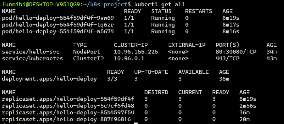
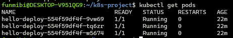
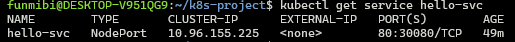
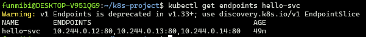
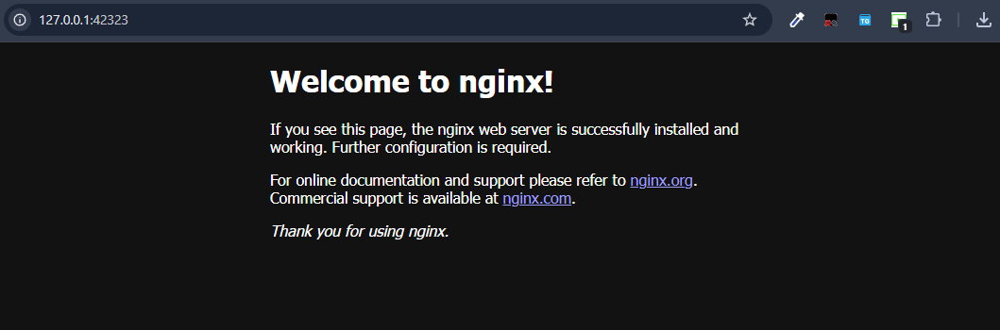
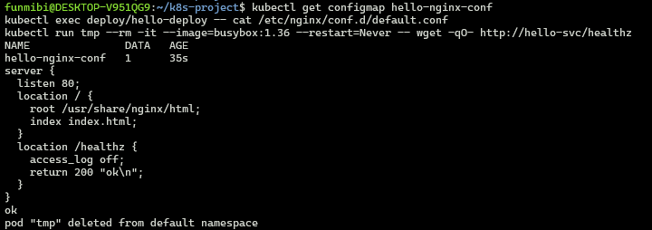
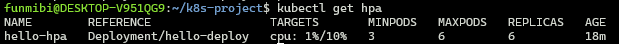
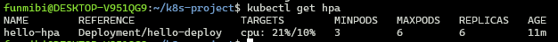
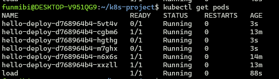

# Introduction to Container Orchestration with Kubernetes

This project sets up a local Kubernetes cluster with Minikube and uses `kubectl` to deploy, expose, inspect, troubleshoot and resource-limit a sample nginx application. All workloads are defined declaratively in YAML manifests.

## 1. Tools and environment

| Tool | Version |
|---|---|
| OS | Windows with WSL2, Ubuntu 24.04 |
| Container runtime | Docker 29.7.1 |
| Local Kubernetes distribution | Minikube v1.39.0 (Docker driver) |
| CLI | kubectl v1.36.3 |
| Cluster Kubernetes version | v1.35.1 (single node, `minikube`) |

kubectl is one minor version ahead of the cluster, which is within the supported version skew.

## 2. Project structure

```
k8s-project/
 -- README.md
 -- manifests/
     --pod.yaml
     -- deployment.yaml
     -- service.yaml
     -- configmap.yaml
     -- hpa.yaml
-- evidence/
     -- (kubectl output, describe output and troubleshooting files)
 -- screenshots/
    -- kubectl-get-all.png
    -- kubectl-get-pods.png
    -- service-hello-svc.png
    -- endpoints-hello-svc.png
    -- nginx-welcome.png
    -- configmap-verification.png
    -- hpa-idle.png
    -- hpa-scaling.png
    -- hpa-pods.png
```

## 3. Setup process

### Task 1: Environment setup

Docker and kubectl were already installed. Minikube was installed from the official Linux binary:

```bash
curl -LO https://github.com/kubernetes/minikube/releases/latest/download/minikube-linux-amd64
sudo install minikube-linux-amd64 /usr/local/bin/minikube
rm minikube-linux-amd64
```

Versions were verified with:

```bash
docker --version
minikube version
kubectl version --client
```

### Task 2: Cluster initialization

```bash
minikube start --driver=docker
kubectl cluster-info
kubectl get nodes
```

`kubectl cluster-info` showed the control plane and CoreDNS running, and `kubectl get nodes` showed one node, `minikube`, in `Ready` state with the `control-plane` role. Minikube reported that the old `minikube` container was missing and recreated it, which was expected because the profile was left over from earlier use.

### Task 3: Pod deployment

A single nginx Pod was created from `manifests/pod.yaml`:

```bash
kubectl apply -f manifests/pod.yaml
kubectl get pod hello-pod -o wide
kubectl delete pod hello-pod
kubectl get pods
```

After deletion, `kubectl get pods` returned `No resources found in default namespace`. A bare Pod is not recreated once it is deleted because nothing is managing it, which is the reason Deployments are needed.

### Task 4: Deployment configuration

`manifests/deployment.yaml` defines a Deployment with 3 replicas. To test automated recovery, one Pod (`hello-deploy-85b4597f54-7fkbh`) was deleted. The Deployment's ReplicaSet immediately created a replacement (`hello-deploy-85b4597f54-bl92d`), restoring the count to three without manual action.

```bash
kubectl apply -f manifests/deployment.yaml
kubectl get pods
kubectl delete pod hello-deploy-85b4597f54-7fkbh
kubectl get pods
```

### Task 5: Service networking

`manifests/service.yaml` defines a NodePort Service that selects Pods labelled `app: hello`.

```bash
kubectl apply -f manifests/service.yaml
kubectl get service hello-svc
kubectl get endpoints hello-svc
```

- **Internal access:** a temporary busybox Pod fetched the nginx page by the Service's DNS name:
  `kubectl run tmp --rm -it --image=busybox:1.36 --restart=Never -- wget -qO- http://hello-svc`
- **External access:** `minikube service hello-svc --url` printed a local URL (with the Docker driver, this command must stay running), and the nginx welcome page loaded in the browser.

The Service had ClusterIP `10.96.155.225`, port mapping `80:30080/TCP`, and three endpoints (`10.244.0.5:80`, `10.244.0.7:80`, `10.244.0.8:80`), which matched the three Pod IPs.

### Task 6: Cluster inspection

```bash
kubectl get all
kubectl describe deployment hello-deploy
kubectl describe pod <pod-name>
kubectl describe service hello-svc
kubectl logs <pod-name>
```

Findings:

- The Deployment reported `3 desired | 3 updated | 3 total | 3 available | 0 unavailable`.
- Each Pod was `Running`, `Ready: True`, with `Restart Count: 0`, and was controlled by the ReplicaSet.
- The Pod logs showed requests from `Wget` (the internal busybox test) and from a Chrome browser (the external test), confirming both access paths reached the Pods. The `favicon.ico` 404 entries are the browser requesting a site icon that the default nginx image does not have.
- At this stage the Pods showed `QoS Class: BestEffort` because no requests or limits were set.

### Task 7: Resource troubleshooting

Failures were created or encountered, then diagnosed and fixed. See section 5.

### Task 8: Resource management

CPU and memory requests and limits were added to the container in `manifests/deployment.yaml` and applied. A new ReplicaSet rolled out new Pods.

```bash
kubectl apply -f manifests/deployment.yaml
kubectl rollout status deployment/hello-deploy
kubectl describe pod <new-pod-name>
kubectl describe node minikube | grep -A8 "Allocated resources"
```

Results:

- Before: `QoS Class: BestEffort`.
- After: `Requests: cpu 100m, memory 64Mi`, `Limits: cpu 250m, memory 128Mi`, and `QoS Class: Burstable`.
- The node's Allocated resources section includes these requests and limits alongside the system Pods in `kube-system`. Three Pods account for 300m CPU and 192Mi memory of requests, and 750m CPU and 384Mi memory of limits.

### Additional improvements

#### Liveness and readiness probes

Both probes were added to the container in `manifests/deployment.yaml`. The readiness probe controls whether a Pod receives Service traffic, and the liveness probe controls whether Kubernetes restarts the container. `kubectl describe pod` shows both (`Liveness: http-get http://:80/ delay=10s period=10s`, `Readiness: http-get http://:80/ delay=5s period=5s`).

#### ConfigMap mounted as a volume

`manifests/configmap.yaml` holds a custom nginx server config, which is mounted into the Pods at `/etc/nginx/conf.d`. It adds a `/healthz` route that the default nginx config does not have. Verification: `kubectl exec deploy/hello-deploy -- cat /etc/nginx/conf.d/default.conf` printed the custom config, and `wget http://hello-svc/healthz` from a temporary Pod returned `ok`.

#### HorizontalPodAutoscaler

`manifests/hpa.yaml` scales `hello-deploy` between 3 and 6 replicas, targeting 10% average CPU utilization (measured against the 100m CPU request). The `metrics-server` addon (`minikube addons enable metrics-server`) is required. With the Pods idle the HPA showed a low CPU percentage with 3 replicas. While a busybox Pod looped `wget` requests against the Service, CPU rose above the target and the HPA added Pods (see the screenshots in section 6).

## 4. Manifest files

### `manifests/pod.yaml`

A single nginx Pod. It shows the smallest deployable unit but has no self-healing.

```yaml
apiVersion: v1
kind: Pod
metadata:
  name: hello-pod
  labels:
    app: hello
spec:
  containers:
    - name: nginx
      image: nginx:1.27
      ports:
        - containerPort: 80
```

### `manifests/deployment.yaml` (final version)

Manages three replicas of the nginx Pod, restores them automatically if one is deleted, performs rolling updates, sets resource requests and limits, defines liveness and readiness probes, and mounts the nginx ConfigMap as a volume.

```yaml
apiVersion: apps/v1
kind: Deployment
metadata:
  name: hello-deploy
spec:
  replicas: 3
  selector:
    matchLabels:
      app: hello
  template:
    metadata:
      labels:
        app: hello
    spec:
      containers:
        - name: nginx
          image: nginx:1.27
          ports:
            - containerPort: 80
          resources:
            requests:
              cpu: "100m"
              memory: "64Mi"
            limits:
              cpu: "250m"
              memory: "128Mi"
          readinessProbe:
            httpGet:
              path: /
              port: 80
            initialDelaySeconds: 5
            periodSeconds: 5
          livenessProbe:
            httpGet:
              path: /
              port: 80
            initialDelaySeconds: 10
            periodSeconds: 10
          volumeMounts:
            - name: nginx-conf
              mountPath: /etc/nginx/conf.d
      volumes:
        - name: nginx-conf
          configMap:
            name: hello-nginx-conf
```

### `manifests/service.yaml`

Gives the Pods a stable virtual IP and DNS name, load-balances across Pods matching `app: hello`, and exposes them on node port 30080.

```yaml
apiVersion: v1
kind: Service
metadata:
  name: hello-svc
spec:
  type: NodePort
  selector:
    app: hello
  ports:
    - port: 80
      targetPort: 80
      nodePort: 30080
```

### `manifests/configmap.yaml`

Provides the nginx server config that is mounted into the Pods, including a `/healthz` route.

```yaml
apiVersion: v1
kind: ConfigMap
metadata:
  name: hello-nginx-conf
data:
  default.conf: |
    server {
      listen 80;
      location / {
        root /usr/share/nginx/html;
        index index.html;
      }
      location /healthz {
        access_log off;
        return 200 "ok\n";
      }
    }
```

### `manifests/hpa.yaml`

Scales the Deployment between 3 and 6 replicas based on CPU utilization.

```yaml
apiVersion: autoscaling/v2
kind: HorizontalPodAutoscaler
metadata:
  name: hello-hpa
spec:
  scaleTargetRef:
    apiVersion: apps/v1
    kind: Deployment
    name: hello-deploy
  minReplicas: 3
  maxReplicas: 6
  metrics:
    - type: Resource
      resource:
        name: cpu
        target:
          type: Utilization
          averageUtilization: 10
```

## 5. Troubleshooting log

### Issue 1: `ImagePullBackOff` from a bad image tag

- **Symptom:** After applying an updated Deployment, a new Pod (`hello-deploy-887f968f6-j9jq9`) stayed at `0/1` and moved from `ContainerCreating` to `ImagePullBackOff`. The three original Pods kept running.
- **Commands used:** `kubectl get pods`, `kubectl describe pod hello-deploy-887f968f6-j9jq9`, `kubectl rollout status deployment/hello-deploy`.
- **Diagnosis:** The Events section showed `Failed to pull image "nginx:1.99-typo": ... manifest for nginx:1.99-typo not found`. The Pod had been scheduled successfully, and the failure occurred only at the image pull step, so the cause was a non-existent tag in the manifest and not a cluster or network problem.
- **Fix:** Changed the image back to `nginx:1.27` in `manifests/deployment.yaml` and re-applied it. The Deployment returned to the original ReplicaSet (`85b4597f54`), the broken Pod was removed, and `kubectl rollout status` reported a successful rollout.
- **Lesson:** The rolling update kept the three healthy Pods serving traffic while the new Pod failed, so the application stayed available.

### Issue 2: Pod stuck in `Pending` from an unschedulable memory request

- **Symptom:** After setting the memory request and limit to `64Gi`, a new Pod (`hello-deploy-5c7cf6fd48-d6xxh`) stayed in `Pending` and never started, while the healthy Pods continued running.
- **Commands used:** `kubectl get pods`, `kubectl describe pod hello-deploy-5c7cf6fd48-d6xxh`.
- **Diagnosis:** The Events section showed a `FailedScheduling` warning: `0/1 nodes are available: 1 Insufficient memory`. There was no `Scheduled` event, so the Pod was never assigned to a node. The single Minikube node did not have 64Gi of unreserved memory.
- **Fix:** Reset the request and limit to `64Mi` and `128Mi` and re-applied the manifest. The Pending Pod was removed and all three Pods returned to `Running`.
- **Lesson:** The scheduler places Pods using resource requests, not actual usage, so an unrealistic request makes a Pod unschedulable.

### Issue 3: Container restarts from a failing liveness probe

- **Symptom:** After changing a probe path in the Deployment, a Pod (`hello-deploy-59898d4c4f-xkwnq`) was restarted repeatedly.
- **Commands used:** `kubectl get pods`, `kubectl describe pod hello-deploy-59898d4c4f-xkwnq`.
- **Diagnosis:** The Events showed `Liveness probe failed: HTTP probe failed with statuscode: 404`, followed by `Container nginx failed liveness probe, will be restarted`.
- **Fix:** Set the probe path back to `/` and re-applied the manifest. The rollout completed and all three Pods returned to `1/1 Running`.
- **Lesson:** A failing liveness probe makes Kubernetes restart the container, whereas a failing readiness probe only removes the Pod from the Service endpoints.

### Issue 4: HPA showed `<unknown>` because the metrics API was unavailable

- **Symptom:** After applying the HPA, `kubectl get hpa` showed `cpu: <unknown>/20%` and `kubectl top pods` returned `error: Metrics API not available`.
- **Commands used:** `kubectl get hpa`, `kubectl describe hpa hello-hpa`, `kubectl top pods`, `kubectl get pods -n kube-system`, `kubectl get apiservice v1beta1.metrics.k8s.io`.
- **Diagnosis:** The HPA Events showed `FailedGetResourceMetric: ... the server is currently unable to handle the request (get pods.metrics.k8s.io)`. The metrics-server addon had only just been enabled and was not ready yet.
- **Fix:** Waited about three minutes until the metrics-server Pod was `1/1 Running` and the API service showed `AVAILABLE True`. `kubectl top pods` then returned values and the HPA showed a percentage.
- **Follow-up:** At 21% usage against a 20% target the HPA did not scale, because the HPA ignores deviations within about 10% of the target. Lowering the target to 10% made the same load clearly exceed it.
- **Lesson:** An HPA depends on the metrics server, and it reports `<unknown>` instead of failing outright when metrics are unavailable.

### Minor issues encountered

- **`403 Forbidden` for `system:anonymous`:** This appeared when the API server address from `kubectl cluster-info` was opened in a browser. A browser has no client certificate, so the request was anonymous and refused. It confirmed the API server was running and enforcing authentication. `kubectl` works because it uses the credentials in the kubeconfig.
- **Shell errors from pasted placeholders:** Pasting the literal `<pod-name>` placeholder produced `syntax error near unexpected token 'newline'`, because the shell treats `<` as input redirection. Using real names from `kubectl get pods` fixed it.

## 6. Verification

Final cluster state, from `kubectl get all` (also saved in `evidence/kubectl-get-all.txt`):

```
PASTE THE OUTPUT OF: cat evidence/kubectl-get-all.txt
```

### Screenshots

**All resources (`kubectl get all`)**



**Pods (`kubectl get pods`)**



**Service (`kubectl get service hello-svc`)**



**Endpoints (`kubectl get endpoints hello-svc`)**



**External access: nginx welcome page through the NodePort Service**



**ConfigMap verification (mounted config and `/healthz` returning `ok`)**



**HPA at idle (3 replicas, low CPU)**



**HPA under load (CPU above target, replicas increasing)**



**Pods after scale-up**



## 7. Key takeaways

- A bare Pod is not recreated when deleted. A Deployment keeps the desired number of replicas running and replaces failed Pods automatically.
- Pods are replaceable and their IPs change. A Service gives a stable address and DNS name and finds Pods through label selectors.
- Declarative YAML manifests describe the desired state, and `kubectl apply` makes the cluster match it. Reverting a manifest to a previous working version is a simple rollback.
- `kubectl get`, `describe` and `logs` give a clear workflow for troubleshooting: check the status, read the Events section, then read the logs.
- Resource requests affect scheduling, and limits cap usage. Setting both changes the Pod's QoS class from `BestEffort` to `Burstable`.
- Readiness probes gate Service traffic, and liveness probes trigger restarts, so a wrong probe path causes very different symptoms for each.
- A ConfigMap separates configuration from the container image, so the nginx config can change without rebuilding anything.
- An HPA needs the metrics server and CPU requests on the Pods. It also ignores small deviations from its target, so a target close to the real usage may never trigger scaling.

## 8. Cleanup

```bash
kubectl delete -f manifests/
minikube stop
minikube delete
```
